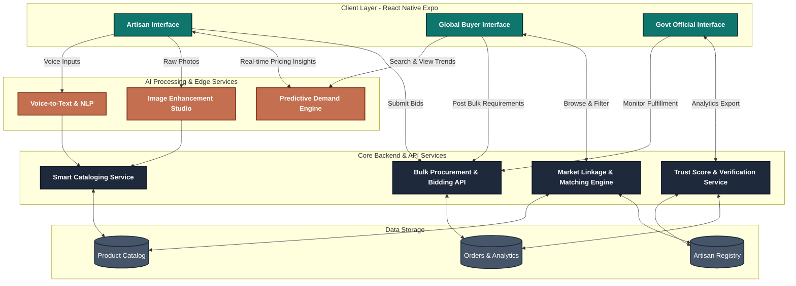

# Kala Setu: Technical Architecture & Workflow

This document outlines the technical workflow and data architecture for the Kala Setu platform, illustrating how the mobile frontend, AI services, and backend systems interact across the three distinct user roles.

## System Architecture Diagram

## Workflow Breakdown

### 1. Smart Cataloging Workflow (Artisan)
1. **Input:** An artisan takes a raw photo of their craft and uses voice notes (via the **Voice-to-Text & NLP** engine) to describe it in their local language.
2. **Processing:** The **Image Enhancement Studio** automatically removes backgrounds and adjusts lighting. The NLP engine translates and extracts key attributes (e.g., material, dimensions).
3. **Storage:** The **Smart Cataloging Service** structures this data and saves it to the **Product Catalog DB**.

### 2. Market Linkage & Bidding Workflow (Buyer & Artisan)
1. **Demand Creation:** A corporate buyer posts a bulk requirement (e.g., "500 Silk Sarees") via the **Bulk Procurement API**.
2. **Matching:** The **Market Linkage Engine** scans the **Artisan Registry** and notifies qualified artisans based on their **Trust Score** and capacity.
3. **Live Bidding:** Artisans submit their competitive bids. The buyer reviews these bids in real-time and allocates the order, which is tracked in the **Orders DB**.

### 3. Analytics & Governance Workflow (Govt)
1. **Data Aggregation:** The **Trust Score & Verification Service** continuously aggregates sales volume, fulfillment rates, and credit scores from the database.
2. **Oversight:** Government officials access read-only dashboards to monitor state-wide active procurements and export impact reports for compliance and grant allocation.
